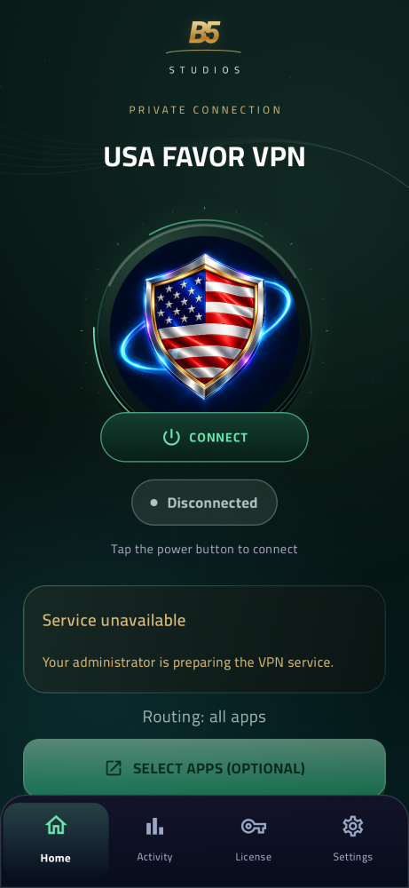
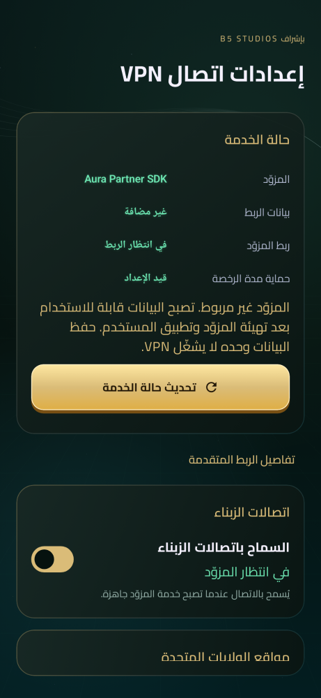

# USA VPN / B5 STUDIOS ADMIN

Native Android project on branch **usa-favor-vpn**, in [USA-FAVOR-VPN/](USA-FAVOR-VPN/).

## Current test downloads — 1.3.0-studio

- [USA VPN client APK](USA-FAVOR-VPN/Downloads/1.3.0-studio/USA-VPN.apk)
- [B5 STUDIOS Admin APK](USA-FAVOR-VPN/Downloads/1.3.0-studio/USA-Admin.apk)
- [Complete ZIP package](USA-FAVOR-VPN/Downloads/1.3.0-studio/USA-FAVOR-Complete.zip)
- [Checksums and optional x86_64 client](USA-FAVOR-VPN/Downloads/1.3.0-studio/)
- [Current verification](USA-FAVOR-VPN/Documentation/VERIFICATION.md)
- [Admin sections, code tools, packages and updates](USA-FAVOR-VPN/Documentation/STUDIO.md)

The Client launcher label is USA VPN. One unused code can activate on any customer's installation, then binds to that first installation and retains access until its original expiry. Subsequent disconnect/reconnect does not consume another code. Admin supports Arabic/English, RTL, saved-owner biometric/device unlock, license management, remote sections/HTML tools, JSON package import, update notices and Android's user-confirmed installer.

**These are Debug test builds.** Live Firebase deployment and actual customer activation are unverified. No authorized provider account/supported VPN SDK is supplied; real VPN remains unavailable. Owner authentication cannot be self-granted by the APK, and a new native provider SDK cannot be added through remote settings alone. Updates need a matching signing key.

### Actual native Compose renders

| Client | Arabic Admin |
|---|---|
|  |  |

These are software UI renders, not physical-device or live tunnel evidence. The earlier [generated visual proposal](USA-FAVOR-VPN/Assets/Design-Concepts/B5-STUDIOS-VPN-Concept.png) is a concept image.

Validation: **31 Android render/policy tests + 10 provider bridge tests passed locally; 26 Firestore emulator tests passed in [GitHub Actions](https://github.com/facemook-a/Facebbokkl/actions/runs/41332145781)**. Both APKs build; final Lint reports contain zero warnings/errors. These checks do not establish live deployment or VPN connectivity.
