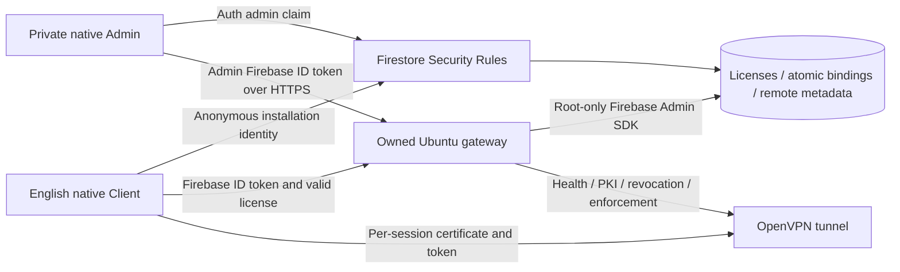

# Runtime architecture — version 1.1.0-spark

The free licensing path has no deployed custom server or Cloud Function. SecureRandom creates USA-XXXX-XXXX sale codes in the private Admin app; Firestore rules restrict creation to admin:true and enforce server timestamps and atomic first activation. A UID represents one installation, not tamper-proof hardware. Another installation is rejected and can record an immutable conflict for admin review; no automatic ban can be triggered by an attacker's second-device attempt.

Firestore carries safe content/server configuration only. Custom cards can be shown/hidden/ordered, and Admin dashboard panels configured. The Client refreshes remote information every five minutes while its model is active. License invalidation has a snapshot listener and is rechecked when requesting a tunnel. Expiry derives from trusted timestamps. Admin reset preserves the original paid period.

A registered compatible gateway is independently provisioned on an owned VPS. Its root service uses Firebase Admin SDK credentials to validate authenticated users, check live licenses, issue random session tokens and ephemeral per-session certificates, and run OpenVPN. Android never receives root keys or service-account credentials. Control operations require admin claims and verified gateway identity/health; merely saving a hostname/profile is not proof of control. Display country does not establish egress geography.

Session tokens have a one-hour maximum bounded by license expiry. Authorization results are cached for at most 45 seconds, expiry is checked on each use, and active tunnel sessions are swept every 15 seconds (plus network/load delays). Firestore failure is fail-closed after cache validity. Gateway systemd ties OpenVPN to the authorization agent. Measure revocation latency on the actual VPS before selling access.

Connected requires a real OpenVPN callback and HTTPS public-IP verification bound to Android's VPN network, matching the gateway's configured real egress IPv4. Ongoing verification, engine byte counters, VPN permission and foreground service are implemented; live tunnel success has not been verified here. Unsupported protocols/native Android changes still require a new APK.
