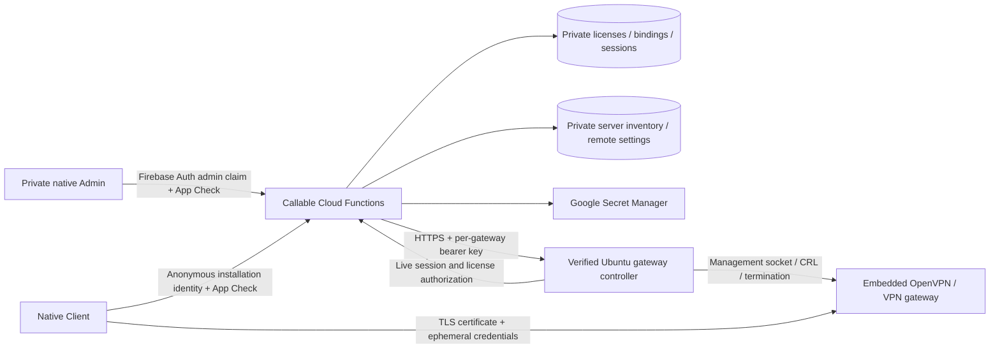

# Runtime architecture

The customer never enters an email/password. Firebase anonymous authentication provides an installation identity; it does not authorize VPN use by itself. Atomic license activation binds that UID. Android backups/device transfer are excluded. Reinstallation creates a new identity and requires an administrator binding reset.

All database access is server-side; Firestore denies direct reads and writes, including from administrators. Admin claim checks are repeated in each privileged callable. Callable APIs require App Check, installation authentication and per-UID/IP rate limits. Audit events store actor/action/target, not credentials.

Codes are generated with cryptographic randomness from an ambiguity-reduced alphabet, in USA-XXXX-XXXX form. The document ID is a SHA-256 protected lookup identifier. Raw codes are retained only in private admin-accessible storage so an administrator can copy them later. Times are assigned by the trusted backend clock; audit entries use Firestore server timestamps. Subscription duration starts either at generation or first activation. Transactions enforce one binding. A reset preserves the paid expiry. Revocation, deletion and reset invalidate issued sessions. Extending a revoked license does not silently reactivate it.

Each session has a random 256-bit token (only its hash is stored in Firestore), one-hour maximum validity bounded by license expiry, and a per-session EC client certificate/private key plus tls-crypt-v2 material. Session credentials are delivered only to the authorized client over TLS. The embedded engine stores temporary profiles under Android Keystore AES-GCM encryption. No uploaded or shared customer private key is embedded in APK resources.

The gateway checks authorization on every handshake, then periodically revalidates established clients. Backend failure denies handshakes and existing authorization; unauthorized sessions are terminated and their certificate revoked. Parallel validation limits delays under load. There is polling/network latency, not instantaneous global revocation. Three consecutive management-channel failures stop OpenVPN. Systemd binds OpenVPN to the authorization agent so agent failure also stops the VPN. Maximum configured capacity is 200 sessions per /24 gateway; add gateways for horizontal scale.

Server registration starts as an unpublished draft. Test/publish calls verify authenticated management access, TLS, gateway identity, running OpenVPN, and matching endpoint/DNS settings. Importing an OVPN profile only returns a sanitized summary; it cannot establish management ownership. The control key is read dynamically from `usa-favor-gateway-ID` in Secret Manager; it never appears in public Firestore or APKs. Adding a provisioned gateway does not require a Functions redeployment or Client APK rebuild.

Remote app settings are a predefined field allowlist. Social URLs permit HTTPS and constrained mailto links. The Client refreshes configuration/license state on launch and every minute while its ViewModel is alive. Authorizing a session always rechecks server-side state. Disabling or removing a gateway blocks authorization, including established clients at the next gateway sweep. A new unsupported protocol/native feature still requires an app release.

Connected requires an actual OpenVPN CONNECTED callback plus an HTTPS request bound to an Android VPN network and egress IP equality with the registered gateway. Verification continues every 15 seconds. Tunnel counters come from the engine's status service. No sample IPs, invented statistics or synthetic progress percentages are shown.
