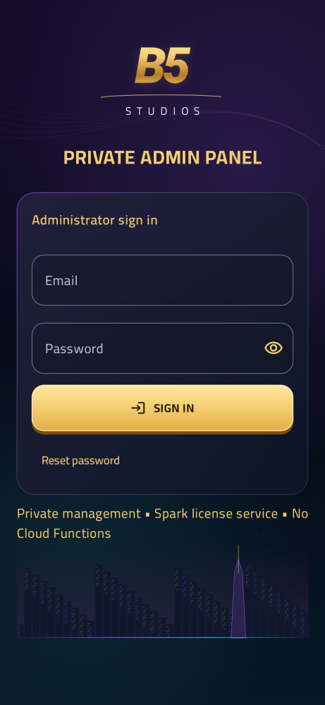
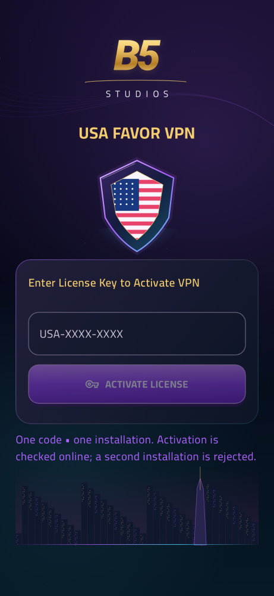
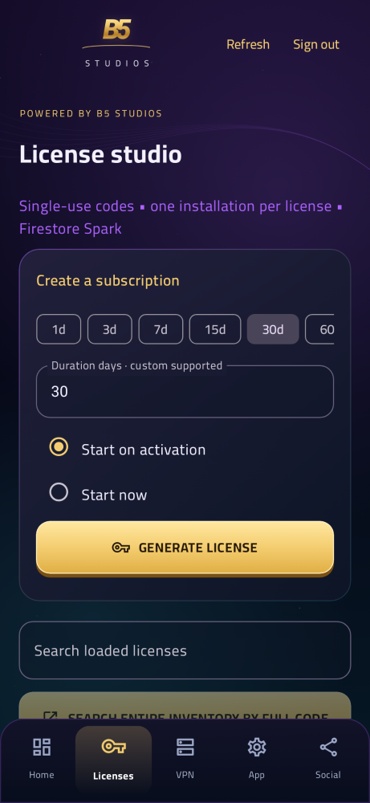
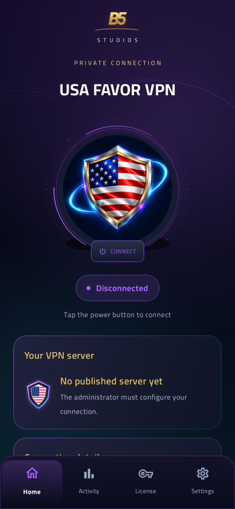
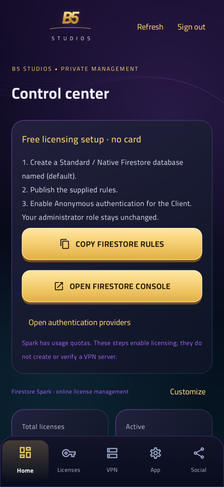
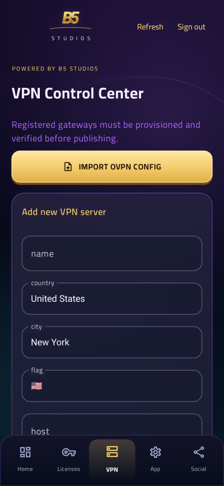
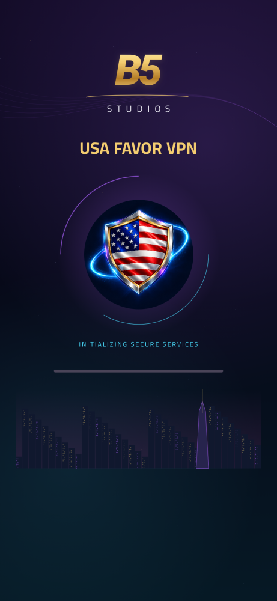

# صور واجهات USA FAVOR VPN — 1.1.0-spark

هاد الصور تصدّرو محلياً من واجهات Jetpack Compose الحقيقية المستعملة فالتطبيقين، باستعمال Paparazzi. ماشي صور مولّدة بالذكاء الاصطناعي، وماشي screenshots من هاتف خدام أو إثبات لاتصال VPN. الحالة فارغة للمعاينة: ما زدنا لا سيرفرات ولا أكواد ولا إحصائيات مختلقة. الهاتف، حجم الخط والنظام يقدرو يبدلو المسافات وشريط الحالة. الصور ثابتة وما كتبينش الحركة.

صور الدخول ولوحة الأدمن والتفعيل والتحميل والرئيسية كتستعمل AdminScreen/ClientScreen مباشرة. صور قسم التراخيص وVPN كتستعمل LicensePage/ServerPage الحقيقيين وسط إطار معاينة مماثل لإطار التطبيق. الـViewModel مُستبدل فاختبار العرض فقط؛ هادشي ما كيزيد حتى وضع تجريبي ولا تجاوز للتراخيص داخل APK. ملفات APK المنشورة ما تبدلاتش فهاد الطلب.

اضغط على الصورة باش تشوفها بوحدها.

| الأدمن: تسجيل الدخول | المستخدم: تفعيل الرخصة |
|---|---|
|  |  |

| الأدمن: توليد الأكواد | المستخدم: الرئيسية قبل نشر خادم |
|---|---|
|  |  |

| لوحة التحكم قبل الإعداد | إدارة خوادم VPN | التحميل |
|---|---|---|
|  |  |  |

إعادة التصدير: نفس بيئة Android/JDK الموثقة فـBUILD.md، ثم `./gradlew -PvisualReview=true :Admin-App:recordPaparazziDebug :Client-App:recordPaparazziDebug`. نجحات 7 لقطات عرض: 4 للأدمن و3 للمستخدم. النتائج فـ../Validation/. هاد الاختبارات كتخرج صور الواجهات وما كتختبرش خادماً حقيقياً أو حساب Firebase منشوراً.
